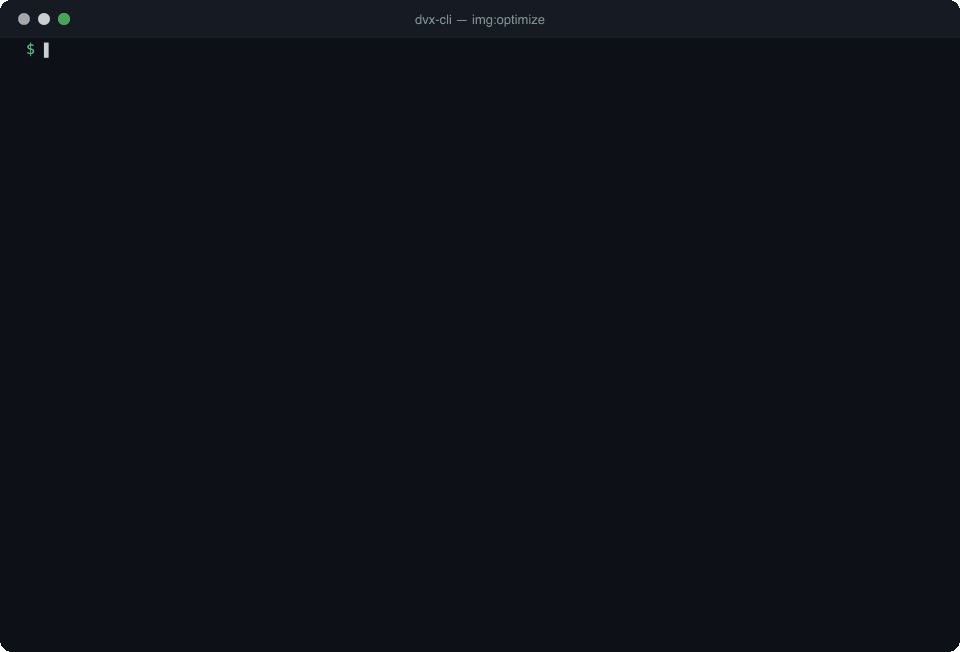

<h1 align="center">dvx-cli</h1>

<p align="center">
  <strong>Image optimization CLI for frontend builds.</strong><br>
  Minify PNG, JPEG, GIF and SVG, convert to WebP, resize with <code>sharp</code>, and validate HTML with HTMLHint, in parallel, from one command.
</p>

<p align="center">
  <a href="https://www.npmjs.com/package/@devexteam/dvx-cli"></a>
  <a href="https://www.npmjs.com/package/@devexteam/dvx-cli"></a>
  <a href="https://github.com/devlegacy/dvx-cli/actions/workflows/nodejs.yml"></a>
  = 24" src="https://img.shields.io/node/v/@devexteam/dvx-cli">
  <a href="LICENSE"></a>
</p>

<p align="center">
  <a href="#quick-start">Quick start</a> ·
  <a href="#commands">Commands</a> ·
  <a href="#use-it-in-your-build-and-ci">CI &amp; scripts</a> ·
  <a href="#faq">FAQ</a> ·
  <a href="https://github.com/devlegacy/dvx-cli/issues">Issues</a>
</p>

<p align="center">
  
</p>

## Why dvx-cli

Optimizing images for the web usually means wiring `imagemin`, `mozjpeg`, `pngquant`, `svgo` and `sharp` together by hand. `dvx` packages that stack behind a few commands with sensible defaults, so a folder of source images becomes a folder of web-ready images (and WebP copies) with one line in your `package.json`.

- **One command per job**: `img:minify`, `img:towebp`, `img:resize`, or `img:optimize` to do all three.
- **Fast on big folders**: files are processed in parallel with worker threads (one per core, minus one).
- **Incremental**: `img:minify` skips images whose optimized copy is already newer than the source, and `img:resize` skips images that already fit.
- **Quality presets**: `--quality high|medium|low` is shared by every image command (see [Quality presets](#quality-presets)).
- **CI friendly**: image commands exit with code `1` when any file fails, and `DVX_LOG_FORMAT=json` prints one JSON object per line.
- **Beyond images**: lint HTML with [HTMLHint](https://htmlhint.com) and strip `sourceMappingURL` comments from CSS in `node_modules`.

<h2 align="center" id="quick-start">📦 Quick start</h2>

Requires **Node.js >= 24**. See [Requirements](#requirements).

```sh
# Run without installing
npx @devexteam/dvx-cli img:optimize --src src/assets/img/src --dist src/assets/img/dist

# Or install it globally and use the `dvx` binary
npm install -g @devexteam/dvx-cli
dvx img:optimize
```

### Install in a project

```sh
npm install --save-dev @devexteam/dvx-cli
```

Then call it from your `package.json` scripts, see [Use it in your build and CI](#use-it-in-your-build-and-ci).

### Requirements

- **Node.js >= 24** (npm >= 11; pnpm >= 12 if you use pnpm).
- On **macOS** some optimizers build native binaries from source on install, so install the libraries first:

  ```sh
  brew install libpng libimagequant
  brew link libpng
  ```

  If `pnpm install` fails building `mozjpeg`, see [docs/troubleshooting-install.md](https://github.com/devlegacy/dvx-cli/blob/master/docs/troubleshooting-install.md).
- Stuck on Node.js 22? The 3.x line supports it: `npm install -g @devexteam/dvx-cli@3`. Its output differs from 4.x, see the [4.0.0 changelog](https://github.com/devlegacy/dvx-cli/blob/master/CHANGELOG.md).

<h2 align="center">🚀 How to use</h2>
<h3 align="center">Show current version</h3>

```sh
  dvx --version
```

<h3 align="center">🔍 Show help</h3>

```sh
  dvx --help
```

Expected output:
```console
Devexteam CLI
Recommend usage: dvx <cmd> [args]

Commands:
  dvx files:clean-sourcemaps  Clean sourcemaps
  dvx html:validate           Validate HTML files for syntax errors and best practices using
                              HTMLHint.
                              Read about rules on:
                              - https://github.com/htmlhint/HTMLHint/wiki/Rules
                              - https://htmlhint.com/docs/user-guide/list-rules
  dvx img:optimize            Comprehensive image optimization: minify, resize, and convert to
                              WebP format
  dvx img:resize              Resize images to specified dimensions while maintaining aspect
                              ratio
  dvx img:minify              Minify and optimize images for better web performance and smaller
                              file sizes
  dvx img:towebp              Convert images to WebP format for better web performance and
                              smaller file sizes

https://devexteam.com - © Copyright 2026
```

Run `dvx <command> --help` to see the options of a single command.

<h2 align="center">Recommendations</h2>

- Use in the **root project path**
- Use in a `bash`/`unix` console
- `sharp` is the default tool for resizing; nothing else needs to be installed for it.
- Optionally install [ImageMagick](https://www.imagemagick.org/script/download.php). It is only used when you pass `--tool mogrify` to `img:resize` or `img:optimize`, and `mogrify` must be available on your `PATH`.
- GraphicsMagick is not used by any command. It only shows up in the report printed by `dvx --version`.

<h2 align="center">Commands</h2>

### `img:minify`

Minify and optimize images (png, jpeg, jpg, gif, svg) for better web performance and smaller file sizes. Images whose optimized copy in the output directory is already newer than the source are skipped, so re-runs only touch changed images.

| Option | Alias | Default | Description |
| --- | --- | --- | --- |
| `--source` | `--src` | `src/assets/img/src` | Source directory containing unoptimized images (png, jpeg, jpg, gif, svg) |
| `--distribution` | `--dist` | `src/assets/img/dist` | Output directory where minified and optimized images will be saved |
| `--quality` | `-q` | `medium` | Compression quality preset: `high`, `medium` or `low` |

```sh
  dvx img:minify --src src/assets/img/src --dist src/assets/img/dist --quality high
```

### `img:towebp`

Convert images to WebP format for better web performance and smaller file sizes.

| Option | Alias | Default | Description |
| --- | --- | --- | --- |
| `--source` | `--src` | `src/assets/img/dist` | Source directory containing images to convert to WebP format |
| `--distribution` | `--dist` | `src/assets/img/dist/webp` | Output directory where converted WebP images will be saved |
| `--quality` | `-q` | `medium` | Compression quality preset: `high`, `medium` or `low` |

```sh
  dvx img:towebp --quality low
```

### `img:resize`

Resize images to the given dimensions while maintaining aspect ratio. Images that already fit within the target size are skipped. Resizing is done in place on the source directory.

| Option | Alias | Default | Description |
| --- | --- | --- | --- |
| `--source` | `--src` | `src/assets/img/dist` | Source directory containing images to resize |
| `--width` | `-w` | `1024` | Target width in pixels for resized images |
| `--height` | `-h` | none | Target height in pixels (optional, maintains aspect ratio if not set) |
| `--tool` | `-t` | `sharp` | Image processing tool: `sharp` or `mogrify` (requires ImageMagick) |
| `--exclude` | `-e` | `opengraph` | File patterns to exclude from resizing (space-separated) |

```sh
  dvx img:resize --src src/assets/img/dist --width 800 --exclude opengraph banner
```

### `img:optimize`

Comprehensive image optimization: minify, resize, and convert to WebP format. It accepts the options of the three commands above.

| Option | Alias | Default | Description |
| --- | --- | --- | --- |
| `--source` | `--src` | `src/assets/img/src` | Source directory containing unoptimized images to process |
| `--distribution` | `--dist` | `src/assets/img/dist` | Output directory for optimized images |
| `--width` | `-w` | `1024` | Target width for resized images in pixels |
| `--height` | `-h` | none | Target height for resized images in pixels (optional) |
| `--tool` | `-t` | `sharp` | Image processing tool for resizing: `sharp` or `mogrify` |
| `--exclude` | `-e` | `opengraph` | File patterns to exclude from processing (space-separated) |
| `--quality` | `-q` | `medium` | Compression quality preset: `high`, `medium` or `low` |

```sh
  dvx img:optimize --width 1280 --quality high
```

### Quality presets

The image commands share the `--quality` presets:

| Preset | JPEG quality | PNG quality range | WebP quality | Zopfli iterations |
| --- | --- | --- | --- | --- |
| `high` | 90 | 0.7 - 0.9 | 85 | 8 |
| `medium` (default) | 80 | 0.65 - 0.85 | 80 | 3 |
| `low` | 70 | 0.5 - 0.7 | 75 | 5 |

Image commands process files in parallel using worker threads and exit with code `1` when any file fails.

### `html:validate`

Validate HTML files for syntax errors and best practices using HTMLHint. See the [HTMLHint rules](https://htmlhint.com/docs/user-guide/list-rules).

| Option | Alias | Default | Description |
| --- | --- | --- | --- |
| `--source` | `--src` | `public` | Directory containing HTML files to validate |

```sh
  dvx html:validate --src dist
```

### `files:clean-sourcemaps`

Clean sourcemap comments (like `/*# sourceMappingURL=foo.css.map */`) from the CSS files of npm packages, since they can cause conflicts in the compiling or packaging process.

| Option | Alias | Default | Description |
| --- | --- | --- | --- |
| `--source` | `--src` | `./node_modules/` | Source path of the files |
| `--packages` | `--pkg` | `bootstrap-datepicker`, `tinymce` | List of npm packages with CSS files to clean |

```sh
  dvx files:clean-sourcemaps --pkg bootstrap-datepicker tinymce
```

<h2 align="center">Environment variables</h2>

| Variable | Description |
| --- | --- |
| `DVX_LOG_FORMAT` | Set to `json` to print one JSON object per line (useful for pipes, CI or log shippers). Any other value keeps the human-readable output. |
| `DVX_LOG_LEVEL` | Log threshold: `fatal`, `error`, `warn`, `info`, `debug`, `trace` or `silent`. Default `info`; unknown values fall back to `info`. |
| `NO_COLOR` | When set, disables colored output. |
| `FORCE_COLOR` | Forces colored output even when stdout is not a terminal. `FORCE_COLOR=0` disables colors. |

Warnings and errors are written to stderr and regular output to stdout, so stdout stays clean for pipes.

```sh
  DVX_LOG_FORMAT=json DVX_LOG_LEVEL=warn dvx img:minify
```

<h2 align="center" id="use-it-in-your-build-and-ci">Use it in your build and CI</h2>

Add the commands to your `package.json` scripts so every contributor runs the same pipeline:

```json
{
  "scripts": {
    "images": "dvx img:optimize --src src/assets/img/src --dist src/assets/img/dist --width 1280 --quality medium",
    "images:webp": "dvx img:towebp --src src/assets/img/dist --dist src/assets/img/dist/webp"
  }
}
```

In GitHub Actions, a failed image makes the step fail because image commands exit with code `1`:

```yaml
- uses: actions/setup-node@v7
  with:
    node-version: 24
- run: npm ci
- run: npx dvx img:minify --src src/assets/img/src --dist src/assets/img/dist --quality high
  env:
    DVX_LOG_FORMAT: json
```

> `html:validate` reports problems but does not set a non-zero exit code yet (tracked in the [roadmap](https://github.com/devlegacy/dvx-cli/blob/master/docs/roadmap.md)), so it will not fail a CI job on its own.

<h2 align="center" id="faq">FAQ</h2>

**How do I convert images to WebP from the command line?**
Run `dvx img:towebp --src <folder> --quality medium`. It writes `.webp` copies to `src/assets/img/dist/webp` by default and leaves the originals untouched.

**How do I compress PNG, JPEG, GIF and SVG files in one command?**
`dvx img:minify` handles all four formats. PNG goes through pngquant and zopfli, JPEG through mozjpeg, GIF through gifsicle and SVG through svgo. Pick `--quality high`, `medium` or `low`.

**Does it overwrite my original images?**
`img:minify` and `img:towebp` read from `--src` and write to `--dist`. `img:resize` resizes **in place** in its source directory, so run it on the optimized output folder, not on your only copy of the originals. `img:optimize` runs minify, resize and WebP conversion from `--src` to `--dist`, writing the `.webp` files next to the minified images.

**Which tool does it use to resize images?**
[`sharp`](https://sharp.pixelplumbing.com) by default, with nothing else to install. Pass `--tool mogrify` to use ImageMagick instead.

**Is it a replacement for `imagemin-cli` or `sharp-cli`?**
It is a thin, opinionated layer on top of the same libraries (`imagemin` plugins and `sharp`), plus parallel workers, incremental runs and presets. If you need full control over every encoder flag, use those libraries directly.

**Does it work on Windows, Linux and macOS?**
It is a Node.js CLI. Native optimizer builds are the usual source of install problems, mainly on macOS (Apple Silicon), see [troubleshooting](https://github.com/devlegacy/dvx-cli/blob/master/docs/troubleshooting-install.md). Please [open an issue](https://github.com/devlegacy/dvx-cli/issues/new/choose) if something fails on your platform.

<h2 align="center">Directory structure example</h2>

📂 `project-root/`     
├─ 📂 `src/`     
│&nbsp;&nbsp;├─ 📂 `assets/`     
│&nbsp;&nbsp;│&nbsp;&nbsp;├─ 📂 `img/`     
│&nbsp;&nbsp;│&nbsp;&nbsp;│&nbsp;&nbsp;├─ 📂 `dist/`     
│&nbsp;&nbsp;│&nbsp;&nbsp;│&nbsp;&nbsp;└─ 📂  `src/`     

<h2 align="center">Roadmap</h2>

Open items are tracked in [docs/roadmap.md](https://github.com/devlegacy/dvx-cli/blob/master/docs/roadmap.md). The next release plans to replace the `imagemin` binaries with `sharp` and `svgo`, which removes the native install step.

<h2 align="center">Contributing and support</h2>

- Found a bug or want a feature? [Open an issue](https://github.com/devlegacy/dvx-cli/issues/new/choose).
- Pull requests are welcome. Run `pnpm run lint`, `pnpm run typecheck` and `pnpm test` first.
- If `dvx` saves you time, a ⭐ on [GitHub](https://github.com/devlegacy/dvx-cli) helps other developers find it.

<h2 align="center">License</h2>

[MIT](LICENSE) © Samuel R. / [Devexteam](https://devexteam.com)

<h2 align="center">Sponsoring</h2>

Thank you for your support! :heart:. Your feedback is highly appreciated.
If you found this project useful and would like to support its development, or if you'd just like to buy me a coffee, you can do so via PayPal:

[](https://www.paypal.com/donate/?hosted_button_id=PT9RLBAVGWA6S)
